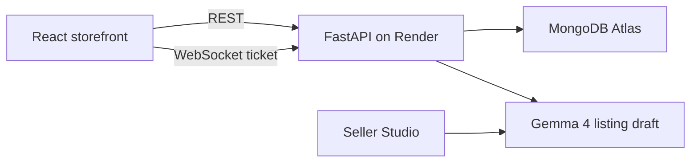

# DEV post draft

Publish this yourself on DEV before 18 October 2026, 11:59 PM PDT (19 October 2026, 12:29 IST). Tags: `devchallenge`, `hf26challenge`. Set the article's AI disclosure to some AI assistance: an agent helped build the product and draft this post.

Replace the bracketed URLs after [deploy.md](deploy.md). Before you publish, delete any prize line that is not true of the running demo. Leave ElevenLabs, Arduino, and .tech out unless you actually used them.

---

## Side hustle, with the price left blank on purpose

CampusCart is the till for a student stall: a wok counter, a print desk, or a coffee cart on one campus. The person who would pay is the student running the stall, because orders stop living in a group chat. Buyers pay with campus-wallet credits they loaded themselves, or when they pick up. Nothing in the app verifies a bank or UPI payment.

The open-weight piece is the listing writer. In Seller Studio, Gemma 4 turns a sentence the seller actually said into a draft. The sample note is "Garlic fried rice, 90 rupees, 12 portions, ready in 15 minutes, hostel pickup." The model may fill only numbers that appear in that sentence. It does not invent a price or a stock count, and it does not publish. The seller reviews the form and saves a draft. A closed "fill this form for me" API that guesses ₹90 when the seller never said it would be worse for this business: the wrong price is a real order.

`GEMMA_BASE_URL` can point the same draft at a local OpenAI-compatible server. Without `GEMMA_API_KEY` and without that URL, the studio says the assistant is not configured and the seller types the listing. That fallback is deliberate.

I have not charged a card, and I have not taken a payment from a seller. A buyer in the demo can spend campus-wallet credit on garlic rice (`RICE20` takes ₹20 off) and on a print job whose price comes from the page count (`INKWALLET` takes ₹10 off a wallet-paid print). The store receives what the student pays.

### Demo

Live app: [paste the Render or .tech URL]

Repo: [paste the public GitHub URL]

Test logins, after the seed script:

- Seller, Kaaram & Ko: `caram.store@campus.test` / `CaramStore1` — run the sample note at the top of Seller Studio, then accept an order.
- Buyer: `student.buyer@campus.test` / `CampusBuyer1` — campus wallet, code `RICE20` at Kaaram & Ko, code `INKWALLET` on a Tanuj Prints file.
- Print desk, Tanuj Prints: `thanooj.prints@campus.test` / `ThanoojPrint1` — Print queue shows the packet name, the spec, and the file. Urgent jobs sit first.
- Admin: `desk.admin@campus.test` / `CampusDesk1`

### Why an open model

The stall's costs only work if the listing writer is cheap to run and does not invent fields. An open-weight model can be swapped (`GEMMA_MODEL`, or a local server) without renting a closed form-filler whose price changes under the seller. The customer's menu text stays in the request to the model they configured. The order, the wallet ledger, and the stock decrement stay in MongoDB, computed on the server in integer minor units.

### Prize categories

- Best Use of Gemma. The sample note in Seller Studio is a Gemma 4 draft. The form stays unpublished until the seller saves it.
- Best Use of Render. The live demo is the `campuscart-api` and `campuscart-web` services from `render.yaml`.
- Best Use of MongoDB Atlas. Orders, listings, and the wallet ledger for that demo sit in an Atlas cluster.

### How it is put together

Chat and live order updates share one socket. The socket accepts the page only when its origin is listed in `CORS_ORIGINS`. Uploaded print files sit on the API disk, which does not survive a Render restart. The seeded stalls do not depend on those files.

Wallet credits are an on-campus ledger: a student records a top-up, and staff can reverse it. Karma, if a listing has it, is not money.
